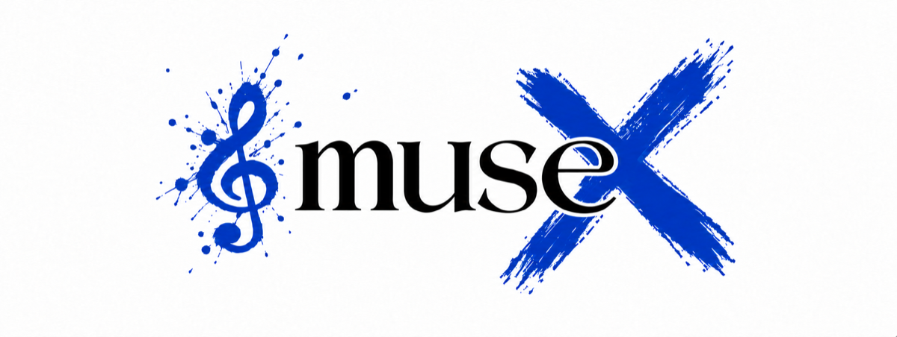

# musex

  

 

`musex` is a Go library for representing and working with musical concepts in software. It is intended to provide building blocks for music editors, analyzers, educational tools, and music generators.

The library focuses on musical concepts and their relationships. It is not a standalone application, digital audio workstation, or sound player.

> **Early development:** The library is not ready for production use, and its public API is not yet stable. The `letter`, `alteration` and `octave/naming` packages are implemented; `letter` was first released in v0.1.0, `alteration` in v0.2.0, and `octave/naming` in v0.3.0. Until v1.0.0, compatibility between releases is not guaranteed beyond what the package documentation states, and the API may change.

<!--
Update the relevant sections in the same PR that adds or changes public functionality.
Describe implemented behavior here; keep future work in ROADMAP.md.
Mark functionality not included in the latest release as unreleased.
-->

## Features

<!-- List implemented capabilities from the user's perspective, grouped by musical topic as needed. -->

### Letters

Package [`letter`](letter/) provides the seven letters used to name notes.

- The seven letters C D E F G A B in canonical order, starting with C.
- Walking the circle of letters upward from any letter, for example A B C D E F G.
- Letter distance between two letters, upward or downward, from 0 to 6.
- Shifting a letter up or down by any number of letter steps, wrapping around the circle: B shifted up by 1 is C.
- Comparing letters, however they were obtained: C shifted up by 9 is E.
- Converting between letters and their ordinals 0 to 6, with an error for numbers out of range.
- Detecting invalid values: the zero value is not a letter and is never treated as C.
- Immutable values that are safe for concurrent use.

### Alterations

Package [`alteration`](alteration/) provides alteration values: how many chromatic units an accidental raises or lowers a letter.

- The five traditional accidentals: natural 0, sharp +1, flat -1, double sharp +2, and double flat -2.
- Any whole number of chromatic units, such as +3 or -4, and exact fractional values, such as +1/2 for a quarter tone up. Fractions are kept in lowest terms: 2/4 is the same value as 1/2.
- Raising or lowering a value by one unit, by any whole number of units, or by another alteration value, whole or fractional: +1/2 raised by +1/2 is a sharp.
- The difference between two values: a sharp is +2 higher than a flat.
- Multiplying a value by a whole number: +1/2 multiplied by 2 is +1.
- Comparing values, however they were obtained, and ordering them by size; checking the direction of a value and whether it is natural or whole.
- The exact value as a fraction in lowest terms, for storage and exchange.
- A guaranteed range of magnitudes up to 2^24 chromatic units with denominators up to 2^16, with exact results inside it. A result outside the range returns an error instead of a rounded or wrapped value.
- The zero value is the natural.
- Immutable values that are safe for concurrent use.

### Octave names

Package [`octave/naming`](octave/naming/) provides catalogs of verbal octave names.

- Built-in Russian, English and German catalogs: the Russian catalog names the octaves with ASPN numbers -1 to 9, the English and German catalogs the octaves 0 to 7.
- The name of an octave by its ASPN number: octave 4 is "one-line" in English and "eingestrichene" in German.
- An empty name, without an error, for an octave that has no name in a catalog. Any `int` is accepted as an ASPN number.
- The ASPN number of an octave by its name, with an error for a name that is not in the catalog.
- Custom catalogs from your own pairs of ASPN numbers and names, with an error when two octaves are given the same name.
- Comparing catalogs by their names, however they were created.
- Exact names: names are stored and looked up exactly as given, without trimming, normalization or case changes.
- Immutable catalogs that are safe for concurrent use.

## Concept

<!-- Define the library's core musical entities, their relationships, and any differences from conventional terminology. Keep definitions aligned with the implemented model. -->

### Letters

- **Letter (basic degree)** — one of the seven letters C, D, E, F, G, A, B. A letter is only a letter name: it has no accidental, octave, or pitch. It is not a notation symbol such as "H" or "do", and it is not a degree of a scale or mode.
- **Circle of letters** — the letters follow one another in a circle: after B comes C again. The circle has no beginning and does not describe pitch height.
- **Canonical order** — the agreed order C D E F G A B, starting with the first letter C. The **ordinal** of a letter is its place in this order, from 0 for C to 6 for B.
- **Letter step** — a move to the neighboring letter around the circle.
- **Letter distance** — the number of letter steps from one letter to another, upward or downward, from 0 to 6. It differs from the conventional interval number, which counts both letters: from C up to E the letter distance is 2, while the interval is a third.
- **Shift** — the letter reached after a given number of letter steps: up for a positive number, down for a negative one.
- **Seven-letter set** — the set of all seven letters. The range of distances 0 to 6 and the shift period of 7 are properties of this set. Sets with a different number of letters are not provided.
- **Invalid value** — a value that poses as a letter but is none of the seven. Operations recognize it and never treat it as C or any other letter.

### Alterations

- **Chromatic unit** — the unit of alteration values: the amount by which a sharp raises a letter. It is not a semitone in general or a position of a musical system: how many positions a chromatic unit spans depends on the system.
- **Alteration value** — the exact number of chromatic units by which an accidental raises a letter (a positive value) or lowers it (a negative value). It is only a number: it has no letter, octave, or pitch, and it is not an accidental symbol, a cent offset, or a modal alteration. Whether a value is allowed in a musical system is a property of that system, not of the value.
- **Natural** — the value 0. It is a value in its own right, not a missing value; the zero value of the type is the natural.
- **Traditional accidentals** — natural 0, sharp +1, flat -1, double sharp +2, and double flat -2. They are not the only values: +3 (a triple sharp) is whole too, and +1/2 and -3/2 are fractional (microtonal) values.
- **Exact value** — a value as a fraction in lowest terms with a positive denominator: 0/1 for the natural and n/1 for a whole value n. There are no decimal approximations.
- **Raising and lowering** — making a new value a + d or a - d, where d is a whole number or another alteration value. The original value does not change.
- **Difference** — a - b: how many chromatic units a is higher than b. It is not an interval, which also needs letters.
- **Order by size** — comparing values as numbers. It is not the order of note pitches, which also depend on the letter, octave, and system.
- **Direction** — raising (a value above 0), lowering (below 0), or natural (0).
- **Guaranteed range** — the values for which the package promises exact results: magnitudes up to 2^24 chromatic units and denominators up to 2^16. It is not a limit on accidentals in music and not a rule of any musical system.

### Octave names

- **Octave** — the range of pitches from C up to the next B.
- **ASPN number** — the number of an octave in the ASPN (scientific pitch notation) octave numbering: the octave that contains middle C is 4, neighboring octaves have consecutive numbers, and any integer is a valid number, including negative ones. The number identifies the octave itself; it is not the written octave of a note, such as a note for a transposing instrument.
- **Octave name** — a word that names an octave, such as "great", "small" or "one-line" in English. A name is not a notation symbol such as c¹ or C₁, and it is not an inflected word form.
- **Catalog of octave names** — a set of pairs of an ASPN number and a name. Each octave has at most one name in a catalog, and different octaves have different names; the same name may appear in different catalogs. A catalog is not an octave numbering, and it has no name of its own.
- **Empty name** — the name of an octave that has no name in a catalog. It is not an error, and a pair with an empty name does not add a name to a catalog. A catalog may have no names at all.
- **Built-in catalogs** — the Russian, English and German catalogs. Their sets of named octaves differ: the octaves -1, 8 and 9 have names only in the Russian catalog. The Russian names for the octaves -1 and 9 are an extension of musex: they follow the pattern of the other names but were not found in the literature.
- **Exact match** — names are compared exactly, byte for byte: "Small" and " small" are not the name "small". Built-in names are in Unicode normalization form NFC, so ё and ß are single characters: "ss" in place of ß does not match.
- **Equal catalogs** — catalogs that name the same octaves with the same names, however they were created.

## Use Cases

<!-- Describe practical musical or educational problems and the outcomes the library enables, in nontechnical language. Focus on why someone would use it, rather than API calls. -->

## Examples

<!-- Use a technical question-and-answer format: how to perform a task, a short explanation, and a link to a working Go example or the relevant API documentation. Add only examples supported by the implemented API. -->

### Letters

All examples below are in [`letter/example_test.go`](letter/example_test.go); their output is checked by `go test`.

- **How do I list all letters?**
  `letter.All()` returns C D E F G A B in canonical order; `letter.Count` is 7. Each call returns a new slice that the caller owns.
  Example: [`ExampleAll`](letter/example_test.go).
- **How do I walk the circle of letters from a given letter?**
  `letter.A.Cycle()` returns A B C D E F G: seven letters going upward, starting with A.
  Example: [`ExampleLetter_Cycle`](letter/example_test.go).
- **How do I find how many letter steps lie between two letters?**
  `letter.B.DistanceUp(letter.D)` is 2: counting upward wraps from B through C to D. `letter.C.DistanceDown(letter.E)` is 5. Both results are from 0 to 6.
  Examples: [`ExampleLetter_DistanceUp`](letter/example_test.go), [`ExampleLetter_DistanceDown`](letter/example_test.go).
- **How do I move a letter up or down by several steps?**
  `letter.C.Shift(9)` is E and `letter.C.Shift(-1)` is B. Any `int` is accepted, without overflow.
  Example: [`ExampleLetter_Shift`](letter/example_test.go).
- **How do I check whether two letters are the same?**
  `letter.C.Shift(9).Equal(letter.E)` is true. An invalid value is not equal to any letter.
  Example: [`ExampleLetter_Equal`](letter/example_test.go).
- **How do I create a letter from a number stored in my data?**
  `letter.FromOrdinal(4)` returns G. A number outside 0 to 6 returns an error that matches `letter.ErrInvalid` with `errors.Is`. `letter.MustFromOrdinal` panics instead and suits values known to be correct.
  Examples: [`ExampleFromOrdinal`](letter/example_test.go), [`ExampleMustFromOrdinal`](letter/example_test.go).
- **How do I detect a value that is not a letter?**
  `l.IsValid()` is false for the zero value `var l letter.Letter` and for any value other than the seven constants.
  Example: [`ExampleLetter_IsValid`](letter/example_test.go).

### Alterations

All examples below are in [`alteration/example_test.go`](alteration/example_test.go); their output is checked by `go test`.

- **What can I do with alteration values?**
  `alteration.MustFromFraction(1, 2).MustRaiseBy(1)` is +3/2, and a sharp minus a flat is +2. `String` prints a fixed form such as `+3/2`; it is not a notation.
  Example: [`Example`](alteration/example_test.go).
- **How do I get the traditional accidentals?**
  `alteration.Natural()`, `Sharp()`, `Flat()`, `DoubleSharp()`, and `DoubleFlat()` return 0, +1, -1, +2, and -2. The zero value `var a alteration.Alteration` is the natural.
  Example: [`Example_signs`](alteration/example_test.go).
- **How do I create a whole value, such as a triple sharp?**
  `alteration.FromInt(3)` returns +3. A value beyond `alteration.MaxMagnitude` returns an error that matches `alteration.ErrOutOfRange` with `errors.Is`; `alteration.MustFromInt` panics instead.
  Example: [`ExampleFromInt`](alteration/example_test.go).
- **How do I create a fractional value, such as a quarter tone?**
  `alteration.FromFraction(1, 2)` returns +1/2. Fractions are reduced and the sign is kept in the numerator: 2/4 is +1/2, 1/(-2) is -1/2, and 4/2 is +2. A zero denominator returns an error that matches `alteration.ErrZeroDenominator`. `alteration.MustFromFraction` panics instead and suits literals.
  Examples: [`ExampleFromFraction`](alteration/example_test.go), [`ExampleMustFromFraction`](alteration/example_test.go).
- **How do I raise or lower a value by one chromatic unit?**
  `alteration.Flat().Raise()` returns the natural, and `Lower` goes the other way. Each operation returns a new value; the usual style is `a = a.MustRaise()`.
  Example: [`ExampleAlteration_Raise`](alteration/example_test.go).
- **How do I raise or lower a value by several units?**
  `alteration.Natural().RaiseBy(3)` is +3, and `alteration.Sharp().RaiseBy(-2)` is -1. `LowerBy` lowers instead. Any `int` is accepted, without overflow.
  Example: [`ExampleAlteration_RaiseBy`](alteration/example_test.go).
- **How do I raise a value by a fraction?**
  `a.Add(d)` raises `a` by any alteration value `d`: +1/2 plus +1/2 is +1, and +1/2 plus +1/3 is +5/6.
  Example: [`ExampleAlteration_Add`](alteration/example_test.go).
- **How do I find how much higher one value is than another?**
  `alteration.Sharp().Sub(alteration.Flat())` is +2, and +1/2 minus +1/3 is +1/6. `Sub` also lowers a value by another value.
  Example: [`ExampleAlteration_Sub`](alteration/example_test.go).
- **How do I check whether two values are the same, or sort them?**
  `MustFromFraction(2, 4).Equal(MustFromFraction(1, 2))` is true, and `==` gives the same answer. `a.Compare(b)` returns -1, 0, or +1 and works with `slices.SortFunc(xs, alteration.Alteration.Compare)`.
  Examples: [`ExampleAlteration_Equal`](alteration/example_test.go), [`ExampleAlteration_Compare`](alteration/example_test.go).
- **How do I multiply a value by a whole number?**
  `a.Mul(k)` returns `a` times `k`: +1/2 times 2 is +1, and -3/2 times 4 is -6.
  Example: [`ExampleAlteration_Mul`](alteration/example_test.go).
- **How do I tell whether a value raises or lowers, or whether it is whole?**
  `a.Sign()` is +1, -1, or 0; `a.IsNatural()` and `a.IsInteger()` report whether the value is 0 or a whole number.
  Examples: [`ExampleAlteration_Sign`](alteration/example_test.go), [`ExampleAlteration_IsInteger`](alteration/example_test.go).
- **How do I store a value and read it back?**
  `a.Fraction()` returns the exact value as a numerator and a positive denominator in lowest terms, and `alteration.FromFraction(a.Fraction())` gives back the same value. `String` is for output only.
  Examples: [`ExampleAlteration_Fraction`](alteration/example_test.go), [`ExampleAlteration_String`](alteration/example_test.go).
- **What happens when a result is too large?**
  The guaranteed range covers magnitudes up to `alteration.MaxMagnitude` (2^24) with denominators up to `alteration.MaxDenominator` (2^16). `alteration.MustFromInt(alteration.MaxMagnitude).Raise()` returns an error that matches `alteration.ErrOutOfRange`; the original value does not change.
  Example: [`Example_outOfRange`](alteration/example_test.go).

### Octave names

All examples below are in [`octave/naming/example_test.go`](octave/naming/example_test.go); their output is checked by `go test`.

- **How do I get the name of an octave?**
  `naming.Russian().Name(4)` is "первая", and `naming.Russian().MustASPN("малая")` is 3.
  Example: [`Example`](octave/naming/example_test.go).
- **Which octaves do the built-in catalogs name?**
  `naming.Russian()` names the octaves -1 to 9; `naming.English()` and `naming.German()` name the octaves 0 to 7. Each call returns a new catalog that the caller owns.
  Examples: [`ExampleRussian`](octave/naming/example_test.go), [`ExampleEnglish`](octave/naming/example_test.go), [`ExampleGerman`](octave/naming/example_test.go).
- **What do I get for an octave without a name?**
  `naming.English().Name(8)` is "", without an error. Any `int` is accepted, including negative numbers.
  Example: [`ExampleCatalog_Name`](octave/naming/example_test.go).
- **How do I find an octave by its name?**
  `naming.Russian().ASPN("первая")` returns 4. A name that is not in the catalog, such as "Первая", returns an error that matches `naming.ErrUnknownName` with `errors.Is`; the number returned with the error is not an answer. `MustASPN` panics instead and suits names known to be correct.
  Examples: [`ExampleCatalog_ASPN`](octave/naming/example_test.go), [`ExampleCatalog_MustASPN`](octave/naming/example_test.go).
- **How do I create my own catalog?**
  `naming.New(map[int]string{4: "middle", -3: "deep", 12: "high"})` creates a catalog in which `ASPN("deep")` is -3. An empty name means "no name". The same name for two octaves returns an error that matches `naming.ErrDuplicateName`; `MustNew` panics instead.
  Examples: [`ExampleNew`](octave/naming/example_test.go), [`ExampleMustNew`](octave/naming/example_test.go).
- **How do I check whether two catalogs are the same?**
  `naming.Russian().Equal(naming.Russian())` is true, although the two pointers differ. A catalog with the pairs 1 "a" and 2 "" is equal to a catalog with the pair 1 "a". Use `Equal`, not `==`, which compares pointers.
  Example: [`ExampleCatalog_Equal`](octave/naming/example_test.go).
