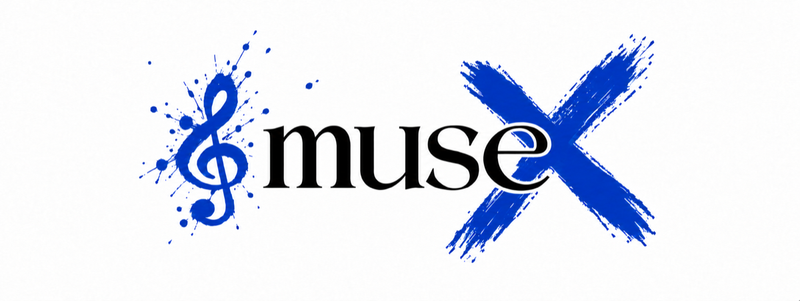

# musex

  

 

`musex` is a Go library for representing and working with musical concepts in software. It is intended to provide building blocks for music editors, analyzers, educational tools, and music generators.

The library focuses on musical concepts and their relationships. It is not a standalone application, digital audio workstation, or sound player.

> **Early development:** Musical functionality is not implemented yet. The library is not ready for production use, and its public API has not been established.

<!--
Update the relevant sections in the same PR that adds or changes public functionality.
Describe implemented behavior here; keep future work in ROADMAP.md.
Mark functionality not included in the latest release as unreleased.
-->

## Features

<!-- List implemented capabilities from the user's perspective, grouped by musical topic as needed. -->

## Concept

<!-- Define the library's core musical entities, their relationships, and any differences from conventional terminology. Keep definitions aligned with the implemented model. -->

## Use Cases

<!-- Describe practical musical or educational problems and the outcomes the library enables, in nontechnical language. Focus on why someone would use it, rather than API calls. -->

## Examples

<!-- Use a technical question-and-answer format: how to perform a task, a short explanation, and a link to a working Go example or the relevant API documentation. Add only examples supported by the implemented API. -->
