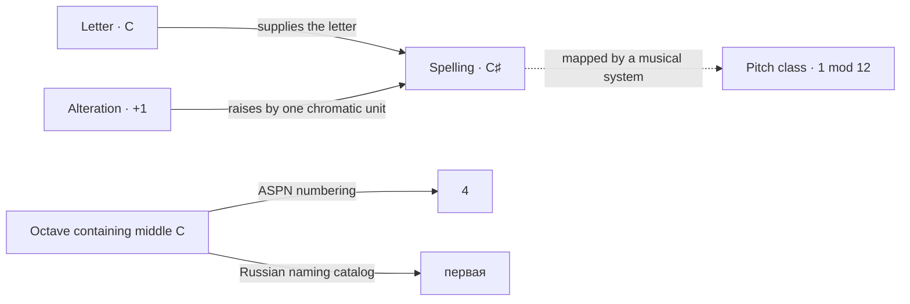
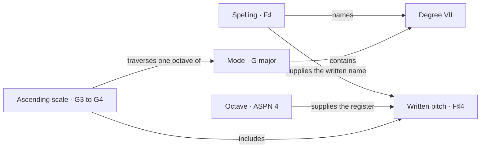

# musex

  

 

`musex` is a Go library for representing and working with musical concepts in software. It is intended to provide building blocks for music editors, analyzers, educational tools, and music generators.

> **Early development.** The library is not yet ready for production use. The public API may change before v1.0.

The [Roadmap and package guide](ROADMAP.md) lists the planned packages and links each implemented package to its chapter. For Go types and functions, see the [API reference](https://pkg.go.dev/github.com/go-muse/musex).

## Concept

A written name combines a letter with an alteration. An octave identifies a register across naming traditions. A pitch class identifies a position that repeats in each octave. In the traditional twelve-position system with C at 0, C♯ and D♭ are different spellings of class 1.

The dotted arrow requires the planned musical system. The next diagram shows the planned model for modes and scales. In the ascending G major scale from G3 to G4, F♯ names the seventh degree and F♯4 is its written pitch.

## Use Cases

**Reading the same score across octave conventions.** A teacher working with a French score and a Russian textbook sees octave 3 in the score and *первая* (“first”) in the textbook. Both refer to the register containing middle C. A teaching tool can look up the register using Franco-Belgian numbering and display its Russian name alongside its ASPN number, 4. The student can then match the passages in both sources.

**Keeping triplet subdivisions exact across a measure.** An editor placing triplet eighth notes in a measure scales an eighth note (`1/8` of a whole note) by `2/3` to get `1/12`. Adding two triplet eighths on the same twelfth-note grid keeps the subdivision `2/12` while reducing to `1/6` of a whole note when only the net span is needed, and advancing to the seventh twelfth-note position `6/12` matches the half-measure mark `1/2` by value while preserving the active `1/12` grid.
