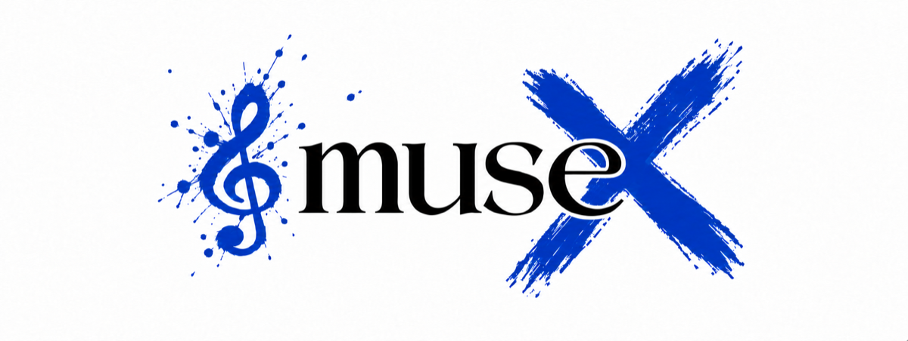
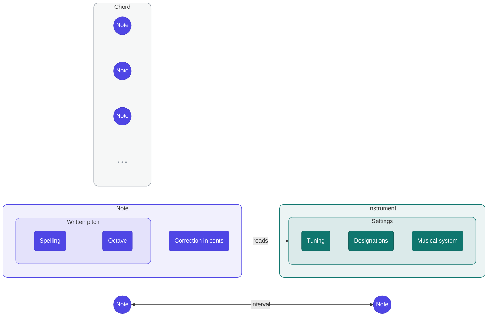

# musex

  

 

`musex` is a Go library for representing and working with musical concepts in software. It is intended to provide building blocks for music editors, analyzers, educational tools, and music generators.

> **Early development.** The library is not yet ready for production use. The public API may change before v1.0.

The [Roadmap and package guide](ROADMAP.md) lists the planned packages and links each implemented package to its chapter. For Go types and functions, see the [API reference](https://pkg.go.dev/github.com/go-muse/musex).

## Concept

`musex` keeps what is written apart from how it sounds. A note is a written record: a spelling such as C♯, usually placed in an octave, with a correction in cents that is zero unless given. It holds no musical system and no tuning. It reads them from a set of settings, for example the one an instrument owns, so retuning the instrument changes the sound of the notes bound to it without rewriting them. A chord holds notes that sound together. An interval is measured between two notes as they are written and is a value of its own: a direction, a size, and a quality. A degree pairs an ordinal number with an optional note and counts numbers in a caller-defined circle without prescribing a mode.

## Definitions

Definitions may differ from conventional ones.

**Spelling** is the name of a note: a **letter**, one of C D E F G A B, with an **alteration**, the change an accidental makes, counted in sharps. C♯ and D♭ are different spellings.

**Octave** is a register on an ordered axis of registers that has no musical ends. The octave that contains middle C is the same octave whether it is numbered 4 in ASPN, numbered 3 in Franco-Belgian numbering, or called one-line in English.

**Musical system** is the set of rules that connects spellings to positions. It fixes how many positions an octave has and gives each spelling it admits a **pitch class**, a position that repeats in every octave; a spelling can be admissible in one system and not in another. In the traditional system of twelve positions C♯ and D♭ share a pitch class; in the system of nineteen positions they do not. No system is assumed by default.

**Written pitch** is a spelling in a positional octave, such as C♯ in octave 4. The octave is the octave of positions that holds the pitch, not the number printed next to the letter: in the traditional system the record B♯3 is B♯ in octave 4. C♯ and D♭ in the same octave are different written pitches.

**Tuning** assigns a frequency to every written pitch. It combines four parts: a musical system; a **temperament**, which fixes the height of every position of the octave in cents; the pitch class the temperament starts from; and a reference such as A4 at 440 Hz.

**Settings** is one unchangeable value that joins a musical system, its tuning, and its **designations**: a textual **notation** for names and octave marks, an octave numbering, and a catalog of octave names. Replacing a part gives a new set of settings.

**Instrument** is the owner of a set of settings. It gives its current set to the notes that read it and replaces the set as a whole, after checking that the new set can stand in for the old one. It also has a name and an optional reference range of pitches.

**Note** is a written record, a spelling or a written pitch, with a **correction** in cents and an optional source of settings. The correction moves the sound and leaves the record as it is. A note has no duration and stores no settings: a bound note reads them from its source at each use, and an unbound note is given them for each operation.

**Interval** is the distance between two spellings, written pitches, or notes as they are written: a direction, a size counted in letters, and a quality such as major or augmented. It is neither a number of semitones nor a frequency ratio: B♯ to C is a diminished second. The **positional size** of an interval is the number of steps it spans in a musical system.

**Chord** is a group of notes that sound together. It keeps the notes in their order of record, repeats included, and has no duration and no harmonic name.

**Degree** is an ordinal number with an optional note. It is not tied to a tonic or mode: its number can be formatted and parsed, and circular operations count positions with an explicit cycle count.

## Use Cases

- **Track positions in a caller-defined cycle.** Create numbered degrees with or without notes, move to neighboring positions or by an arbitrary shift, measure directed and shortest distances, and convert between continuous and normalized numbers while keeping cycle counts explicit.
