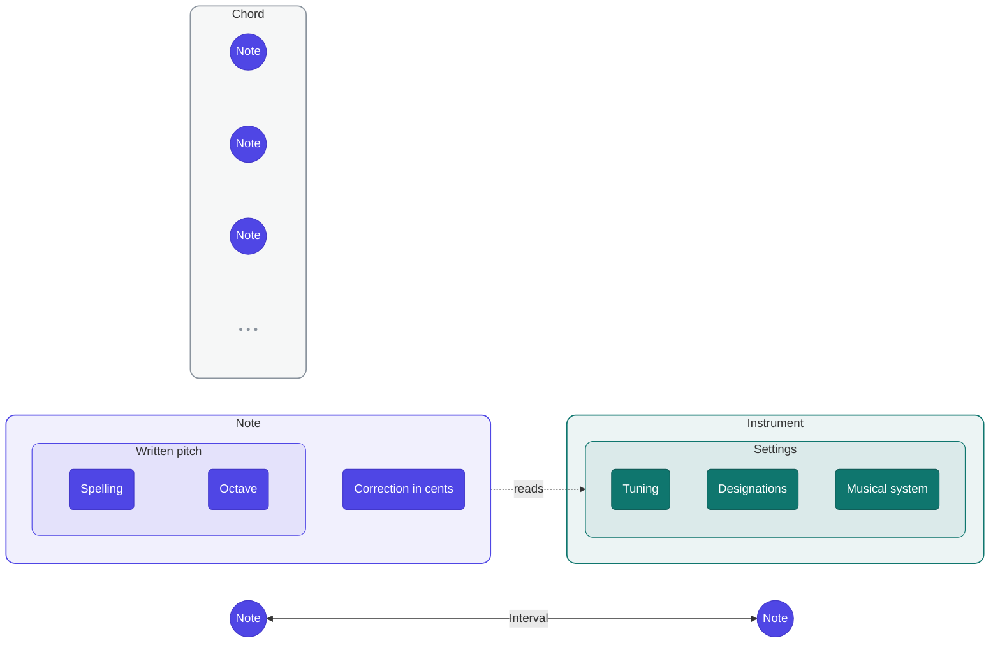

# musex

<p align="center">
  
</p>

[](https://github.com/go-muse/musex/releases/latest)
[](https://github.com/go-muse/musex/blob/main/go.mod)
[](https://pkg.go.dev/github.com/go-muse/musex)
[](ROADMAP.md)
<br>
[](https://github.com/go-muse/musex/actions/workflows/ci.yml?query=branch%3Amain)
[](https://go-muse.github.io/musex/)
[](https://github.com/go-muse/musex/actions/workflows/ci.yml?query=branch%3Amain)
[](https://github.com/go-muse/musex/actions/workflows/ci.yml?query=branch%3Amain)
[](LICENSE)

`musex` is a Go library for representing and working with musical concepts in software. It is intended to provide building blocks for music editors, analyzers, educational tools, and music generators.

> **Early development.** The library is not yet ready for production use. The public API may change before v1.0.

The [Roadmap and package guide](ROADMAP.md) lists the planned packages and links each implemented package to its chapter. For Go types and functions, see the [API reference](https://pkg.go.dev/github.com/go-muse/musex).

## Concept

`musex` keeps what is written apart from how it sounds. A note is a written record: a spelling such as C♯, usually placed in an octave, with a correction in cents that is zero unless given. It holds no musical system and no tuning. It reads them from a set of settings, for example the one an instrument owns, so retuning the instrument changes the sound of the notes bound to it without rewriting them. A chord holds notes that sound together. An interval is measured between two notes as they are written and is a value of its own: a direction, a size, and a quality. A degree pairs an ordinal number with an optional note and counts numbers in a caller-defined circle without prescribing a mode.



## Definitions

Definitions may differ from conventional ones.

**Spelling** is the name of a note: a **letter**, one of C D E F G A B, with an **alteration**, the change an accidental makes, counted in sharps. C♯ and D♭ are different spellings.

**Octave** is a register on an ordered axis of registers that has no musical ends. The octave that contains middle C is the same octave whether it is numbered 4 in ASPN, numbered 3 in Franco-Belgian numbering, or called one-line in English.

**Musical system** is the set of rules that connects spellings to positions. It fixes how many positions an octave has and gives each spelling it admits a **pitch class**, a position that repeats in every octave; a spelling can be admissible in one system and not in another. In the traditional system of twelve positions C♯ and D♭ share a pitch class; in the system of nineteen positions they do not. No system is assumed by default.

**Written pitch** is a spelling in a positional octave, such as C♯ in octave 4. The octave is the octave of positions that holds the pitch, not the number printed next to the letter: in the traditional system the record B♯3 is B♯ in octave 4. C♯ and D♭ in the same octave are different written pitches.

**Tuning** assigns a frequency to every written pitch. It combines four parts: a musical system; a **temperament**, which fixes the height of every position of the octave in cents; the pitch class the temperament starts from; and a reference such as A4 at 440 Hz.

**Settings** is one unchangeable value that joins a musical system, its tuning, and its **designations**: a textual **notation** for names and octave marks, an octave numbering, and a catalog of octave names. Replacing a part gives a new set of settings.

**Instrument** is the owner of a set of settings. It gives its current set to the notes that read it and replaces the set as a whole, after checking that the new set can stand in for the old one. It also has a name and an optional reference range of pitches.

**Note** is a written record, a spelling or a written pitch, with a **correction** in cents and an optional source of settings. The correction moves the sound and leaves the record as it is. A note has no duration and stores no settings: a bound note reads them from its source at each use, and an unbound note is given them for each operation.

**[Interval](guide/packages/interval.md)** is the distance between two spellings, written pitches, or notes as they are written: a direction, a size counted in letters, and a quality such as major or augmented. It is neither a number of semitones nor a frequency ratio: B♯ to C is a diminished second. The **positional size** of an interval is the number of steps it spans in a musical system. `interval.Chromatic` measures and reuses a signed shift in that system; `Generic` and quality palettes recover or enumerate written intervals. Explicit Russian and English dictionaries live in `interval/naming`.

**Mode template** is an ordered record of the intervals between neighboring places of a mode. A closed template repeats after an arbitrary cycle; an open template ends after its last place. Templates can be rotated, compared, serialized, and stored in immutable catalogs with codes and English and Russian names. A template is not a mode and has no tonic, degrees, or musical system.

**[Mode](guide/packages/mode.md)** is a sequence of numbered degrees described by written intervals. It can be open or repeat after an arbitrary cycle. A caller supplies a starting note to build notes or a musical system to compare positional sizes. Its `FromTonic` methods build an independent scale, with optional count, pitch, or octave bounds. Interval witnesses explain family membership, while spelling and pitch membership checks identify actual degree places. Role readings distinguish confirmation, mismatch, and missing context.

**[Scale](guide/packages/scale.md)** keeps a finite ordered list of complete notes. It supports circular traversal and snapshot iterators, exact comparisons and set operations, melody shifts and reflections, editing, transposition, enharmonic spellings, and key signatures.

**[Search](guide/packages/search.md)** finds mode-and-tonic hypotheses whose actual degree notes contain or exactly match a set of input notes. It supports exact-spelling and positional matching in a chosen or context-derived system, tonic-family spellings, and stable grouping without ranking musical likelihood.

**[Modal positions](guide/packages/modal.md)** describe degrees through their specific intervals. Relative analysis returns high, neutral, or low categories together with the full interval from the first degree. Absolute analysis of a closed perfect-octave mode counts five quality families from each degree and orders equal-score groups from brightest to darkest. Integral augmentations and diminutions count once regardless of multiplicity; fractional qualities are unsupported.

**[Tendency and resolution](problemsolving/tendency/README.md)** answers support, degree-label, direction, target, consonance, and two-voice resolution questions under explicit built-in or finite user rules. Coverage and explanations preserve missing context and uncertainty; filters and comparisons retain the original claims.

**[Scale choice](guide/packages/problemsolving/scalechoice.md)** supports a composer's choice of pitch collection: inspect compatible modal readings, common and missing notes, possible continuations, and the consequences of one trial replacement in a set or a phrase. The caller chooses the scope, comparison, condition, and optional center.

**Chord** is a group of notes that sound together. It keeps the notes in their order of record, repeats included, and has no duration and no harmonic name.

**Tempo map** is an immutable timeline of tempo changes and explicit fermata holds at positions or measure addresses. It distinguishes main and current tempo, supports jumps, gradual changes, a tempo, Tempo I, and metric modulation, and converts seconds to and from positions and measures, with one explicitly selected rounding for the complete result.

**[Event](guide/packages/event.md)** is one written element of a voice. It combines a note, chord, or rest with a duration and any ties, fermata, arpeggio, or grace sign.

**Degree** is an ordinal number with an optional note. It is not tied to a tonic or mode: its number can be formatted and parsed, and circular operations count positions with an explicit cycle count.

**MIDI note number** is an integer position from 0 through 127 in the ordinary MIDI map. C4 is 60 and A4 is 69. The number depends on the positional octave, not the register digit: B♯3 and C4 both give 60, while C♭4 and B3 both give 59. Reverse conversion requires an explicit spelling rule; a correction in cents is passed separately and does not change the number.

## Use Cases

- **Convert between the written model and MIDI note numbers.** Create any of the 128 numbers, inspect its positional octave and class, shift it without overflow, and convert written pitches and notes in a traditional C-layout system. Choose the return spelling explicitly with sharps, flats, or a custom rule, attach zero or a specific correction, and handle missing inputs, unsupported layouts, and out-of-range results as distinct errors.
- **Track positions in a caller-defined cycle.** Create numbered degrees with or without notes, move to neighboring positions or by an arbitrary shift, measure directed and shortest distances, and convert between continuous and normalized numbers while keeping cycle counts explicit.
- **Find modes from a set of notes.** Search an immutable built-in or custom catalog by exact spelling or pitch class, choose containment or full match, inspect every matching degree and compatible tonic spelling, and group hypotheses without treating them as musical recognition or ranking.
- **Analyze modal positions.** Pass a mode directly to `modal.Relative` or `modal.GroupRelative` to inspect its degrees. Use `modal.AnalyzeAbsolute` for quality counts, scores, and dense ranks in one complete analysis; equal scores share a rank. Relative analysis also supports open modes and arbitrary cycles.

- **Choose a collection and try a change.** Use `problemsolving/scalechoice` to compare collection groups and readings, filter them by added notes, or branch into a replacement trial with observed-set differences and local written/chromatic motions. Analyses snapshot source contexts and preserve the original material.

### Build a voice event

Given two `note.Note` values `c4` and `e4`, mark the second note of a chord for a tie into the next event. Copy the marks to add a fermata to a new event.

```go
content := event.MustChordContent(chord.MustNew(c4, e4))
written := event.MustWrittenDuration(duration.MustNewWritten(duration.Quarter, 1))
entry := event.MustNew(content, written, event.Marks{Ties: []int{1}})
marks := entry.MustMarks()
marks.Fermata = true
held := entry.MustWithMarks(marks) // entry retains its original marks.
fmt.Println(held.MustMarks().Fermata) // true
```

To represent a three-measure rest, store the measure count. The caller uses its measure grid to find the corresponding length.

```go
rest := event.MustNew(event.RestContent(), event.MustMeasureDuration(3), event.Marks{})
_, err := rest.Length()
if errors.Is(err, event.ErrNeedsMeasureContext) {
    fmt.Println(rest.MustDuration().MustMeasureCount()) // 3
}
```
