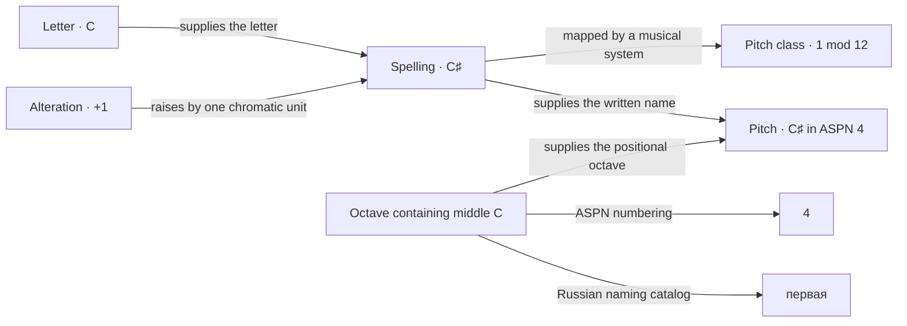
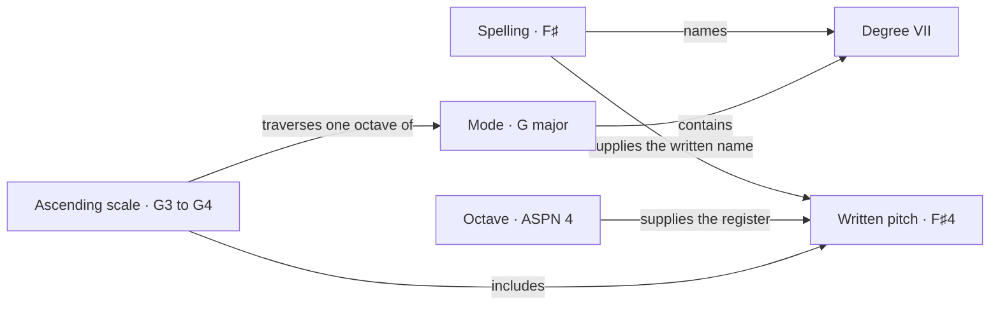

# musex

  

 

`musex` is a Go library for representing and working with musical concepts in software. It is intended to provide building blocks for music editors, analyzers, educational tools, and music generators.

> **Early development.** The library is not yet ready for production use. The public API may change before v1.0.

The [Roadmap and package guide](ROADMAP.md) lists the planned packages and links each implemented package to its chapter. For Go types and functions, see the [API reference](https://pkg.go.dev/github.com/go-muse/musex).

## Concept

A written name combines a letter with an alteration. An octave identifies a register across naming traditions. A written pitch pairs a written name with a positional octave, preserving both parts independently of any musical system or score notation. A pitch class identifies a position that repeats in each octave, and set classes and their twelve-position catalogs classify pitch-class collections by transpositional, inversional, and affine equivalence. A musical system maps admissible spellings to pitch classes and written pitches to positions, steps, and written octaves; no system is assumed by default. In the traditional twelve-position system with C at 0, C♯ and D♭ are different spellings of class 1.

The next diagram shows the planned model for modes and scales. In the ascending G major scale from G3 to G4, F♯ names the seventh degree and F♯4 is its written pitch.

## Use Cases

**Reading the same score across octave conventions.** A teacher working with a French score and a Russian textbook sees octave 3 in the score and *первая* (“first”) in the textbook. Both refer to the register containing middle C. A teaching tool can look up the register using Franco-Belgian numbering and display its Russian name alongside its ASPN number, 4. The student can then match the passages in both sources.

**Keeping triplet subdivisions exact across a measure.** An editor placing triplet eighth notes in a measure scales an eighth note (`1/8` of a whole note) by `2/3` to get `1/12`. Adding two triplet eighths on the same twelfth-note grid keeps the subdivision `2/12` while reducing to `1/6` of a whole note when only the net span is needed, and advancing to the seventh twelfth-note position `6/12` matches the half-measure mark `1/2` by value while preserving the active `1/12` grid.

**Cross-referencing Forte and Carter set-class catalogs.** An analyst comparing an article that cites Forte set class `4-Z15` with a study based on Elliott Carter's *Harmony Book* can look up the class in the twelve-tone catalog, inspect its Rahn and Forte prime forms and interval-class vector, navigate to its Z-partner `4-Z29` or directed $T_n$-types `4-Z15A` and `4-Z15B`, and resolve its corresponding Carter chord number (`18`).

**Tracking written notes across registers and accidentals.** An exercise builder or score editor starts from F♯ in the octave containing middle C (ASPN 4, *первая* in the Russian catalog), generates matching F♯ landmarks across neighboring registers, and raises or strips the accidental while keeping the letter F and its positional octave intact. Because each pitch preserves both its written spelling and its positional octave, C♯ and D♭ in ASPN 4 remain distinct written pitches, and notated B♯3 and C4—which share positional octave ASPN 4 in the traditional system—retain their separate spellings (B♯, ASPN 4) and (C, ASPN 4).

**Comparing a pure fifth with an equal-tempered fifth and two concert pitches.** A pure fifth with the frequency ratio 3:2 is about 1.955 cents wider than the 700-cent fifth of twelve-tone equal temperament. An orchestra tuned to 442 Hz plays about 7.85 cents higher than one tuned to 440 Hz. A tuning utility or temperament lesson can place both differences on the same cent scale so a musician or student sees how small they are beside a 100-cent semitone.

**Matching a chord against scale templates and comparing interval content.** An analysis tool receives the pitch-class set `{0, 4, 7}` in the twelve-position system and checks which transpositions of the major-scale template `{0, 2, 4, 5, 7, 9, 11}` cover all three positions. The positional search returns tonics 0, 5, and 7—identifying C, F, and G major as the major scales containing a C major triad. Comparing `{0, 4, 7}` with its inversion `{0, 3, 7}` also shows that both triads share the interval-class vector `<0, 0, 1, 1, 1, 0>`, explaining why major and minor triads contain the same pair distances despite their opposite orientation.

**Reducing a chord to its prime form and counting embedded subsets.** An analytical pass reduces the pitch-class set `{2, 6, 9}` (D major) to [set class](guide/packages/setclass.md) `3-11` (`(0, 3, 7)`) under transpositional and inversional equivalence or separates it from D minor (`{2, 5, 9}`) as directed type `3-11B` (`(0, 4, 7)`) under transposition alone. Querying Lewin's embedding number `EMB(3-11, 7-35)` shows that the diatonic collection contains six major and minor triads (three of each directed type), while Burnside enumeration counts set classes in microtonal divisions without materializing every subset.

**Analyzing twelve-tone rows and their segments.** A serial-analysis tool reads Webern's op. 28 row `⟨0,11,2,1,5,6,3,4,8,7,10,9⟩` as a [pitch-class sequence](guide/packages/pcseq.md), splits it into three tetrachords, and finds transposition and inversion relations between their contents. It can then generate labelled forms and the row matrix, compare row classes, enumerate derivation operators, and check combinatoriality before verifying the all-interval property of Babbitt's *Du*. Repetitions remain significant in an arbitrary sequence, while a non-invertible multiplication can legitimately collapse a complete row into a sequence with repeated classes.

**Keeping the written octave when an accidental changes.** A notation editor stores the record B3 in the traditional [musical system](guide/packages/system.md). Raising it with the system keeps the written octave and gives B♯3, which has the position of C4—one step above B3—whereas raising the pitch alone keeps its positional octave and gives B♯2. The same system tells the editor that B♯3 and C4 are enharmonically equivalent, that E5 lies 16 steps above C4, and spells the class three steps above C4 as D♯4 with the sharps rule or E♭4 with the flats rule; in the 19-position system the same rules keep C♯ and D♭ apart as different positions.

**Comparing historical temperaments and locating wolf intervals.** A keyboard tuner or musicologist comparing quarter-comma meantone, the well [temperament](guide/packages/tuning/temperament.md) now known as Vallotti's, and twelve-tone equal temperament inspects their exact step offsets in cents, checks the width of every fifth and major third around the circle, and identifies the G♯–E♭ wolf fifth in meantone alongside the smooth key-color gradations of historical well temperaments.

**Choosing explicit rounding for musical grids.** A rhythm editor quantizes 1,234 ticks to a 480-tick grid and selects 960 or 1,440 according to the chosen [rounding rule](guide/packages/common/rounding.md); at the exact midpoint of 1,200 ticks, half-down chooses 960 while half-up chooses 1,440. A tuner can apply the same nine rules on a non-uniform temperament grid, supplying its exact distances, zero reference, and step parity rather than forcing temperament steps onto a uniform numeric scale.

**Importing nested tuplets from a score.** A MusicXML importer reads a sextuplet as six notes in the time of four and keeps the [tuplet](guide/packages/tuplet.md) `6:4` distinct from a triplet `3:2`, although both shorten an eighth note to `1/12` of a whole note. Where a score shows only the number 5, the importer derives `5:4` for a plain beat or `5:3` for a dotted beat. For a triplet nested inside a triplet, it multiplies the coefficients to `4/9` so each inner eighth lasts exactly `1/18` of a whole note and positions stay exact however deeply the groups are nested.
