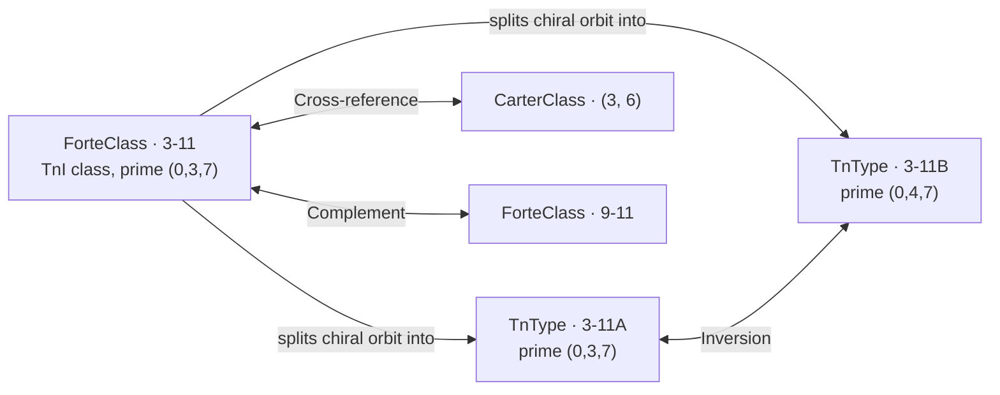

# Set-Class Catalog (`setclass/catalog`)

In post-tonal music theory, pitch-class sets that are related by transposition ($T_n$) or by transposition and inversion ($T_nI$) share the same interval structure and belong to the same set class. Rather than recomputing canonical forms, interval vectors, and structural relationships from scratch every time an analyst inspects a chord or motive, standard theory relies on reference catalogs.

The `setclass/catalog` package provides the complete, read-only reference catalog of twelve-tone equal-tempered ($N = 12$) set classes across all cardinalities $0 \le k \le 12$:

- **224 `ForteClass` entries** — inversional ($T_nI$) set classes, extending Allen Forte's 208 classical classes ($3 \le k \le 9$) with the 16 boundary classes in cardinalities $0, 1, 2, 10, 11, 12$.
- **352 `TnType` entries** — directed transpositional ($T_n$) set classes, distinguishing chiral inversion partners with suffixes `A` and `B`.
- **135 `CarterClass` entries** — Elliott Carter's numbered chord and interval catalog from *Harmony Book* across cardinalities $c \in \{2, 3, 4, 6, 7\}$ ($6 + 12 + 29 + 50 + 38 = 135$), linked in a strict one-to-one bijection with the corresponding `ForteClass` entries.
- **23 `ZPair` entries** — binary pairs of distinct $T_nI$ classes (46 $Z$-related classes in total) that share the exact same 6-element interval-class vector without being related by transposition or inversion.

## Catalog Entities vs. Concrete Pitch-Class Sets

`setclass/catalog` represents **abstract equivalence classes** and their precomputed invariants, not concrete pitch-class sets (`pcset`) or live set-class reductions (`setclass`).

- A concrete pitch-class set (planned in `pcset`) holds a specific collection of pitch classes such as $\{2, 6, 9\}$ (D, F♯, A).
- A catalog entry in `setclass/catalog` represents the canonical equivalence class itself — here `ForteClass` `3-11` with prime form `(0, 3, 7)` and directed transpositional types `3-11A` `(0, 3, 7)` (minor triad) and `3-11B` `(0, 4, 7)` (major triad).

The catalog package has zero external dependencies and performs all lookups in $O(1)$ time over static tables.

## Two Classification Levels: $T_nI$ Classes and Directed $T_n$-Types

Post-tonal analysis uses two standard equivalence relations on the 4,096 subsets of $\mathbb{Z}_{12}$:

1. **$T_nI$-equivalence (`ForteClass`, 224 classes):** Two sets belong to the same Forte class if one can be mapped to the other by transposition $T_n(x) = (x + n) \bmod 12$ or inversion $T_nI(x) = (-x + n) \bmod 12$. Forte notation writes a class as `k-ord` or `k-Zord` (for example, `3-11` or `4-Z15`). The class counts across cardinalities $0..12$ are $1, 1, 6, 12, 29, 38, 50, 38, 29, 12, 6, 1, 1$.
2. **$T_n$-equivalence (`TnType`, 352 types):** Two sets belong to the same $T_n$-type if one is a transposition $T_n$ of the other without inversion.
   - **Inversionally symmetric classes (96 classes):** A set can be inverted into a transposition of itself ($T_nI(S) = T_m(S)$). The $T_nI$ class contains a single $T_n$-type with no suffix (`SuffixNone`, for example `3-1`, `5-Z12`, or `6-Z29`).
   - **Chiral / inversionally asymmetric classes (128 classes):** A set and its inversion form two distinct $T_n$ orbits. The `ForteClass` splits into two directed $T_n$-types with suffixes `A` (`SuffixA`, the prime form of the parent $T_nI$ class) and `B` (`SuffixB`, the prime form of its inversion): $96 + 2 \times 128 = 352$ directed types. The $T_n$-type counts across cardinalities $0..12$ are $1, 1, 6, 19, 43, 66, 80, 66, 43, 19, 6, 1, 1$.

## Packing Algorithms: Rahn vs. Forte

To choose a single canonical representative (prime form) starting on `0` for each equivalence class, theorists pack pitch classes as tightly as possible toward the left (zero). Two packing conventions are standard in the literature:

- **`Rahn` (default, `Algorithm = 0`):** John Rahn's (1980) and Joseph Straus's algorithm minimizes the outer span first, and breaks ties by comparing inner pitch classes from the **right** (from the highest index $k - 1$ down to $1$).
- **`Forte` (`Algorithm = 1`):** Allen Forte's (1973) historical algorithm minimizes the outer span first, and breaks ties by comparing inner pitch classes from the **left** (from index $1$ up to $k - 1$).

In `setclass/catalog`, Rahn prime forms are the default (`PrimeForm()`, `PrimeMask()`, `ForteClassByPrimeForm()`, `TnTypeByPrimeForm()`), while Forte prime forms are available directly (`FortePrimeForm()`, `FortePrimeMask()`) or by passing `Algorithm` (`PrimeFormWith(Forte)`, `ForteClassByPrimeFormWith(form, Forte)`). Both conventions are accepted simultaneously by `ForteClassByAnyPrimeForm` and `TnTypeByAnyPrimeForm`.

### The 6 `ForteClass` Differences ($T_nI$)

Across all 224 $T_nI$ classes, Rahn and Forte prime forms coincide for 218 classes and differ for **6 classes** (`ForteClass.RahnForteDiffer() == true`, yielding $224 + 6 = 230$ distinct canonical prime forms):

| Forte class | Rahn prime form (mask) | Forte prime form (mask) |
|---|---|---|
| `5-20` | `(0, 1, 5, 6, 8)` (`355`) | `(0, 1, 3, 7, 8)` (`395`) |
| `6-Z29` | `(0, 2, 3, 6, 7, 9)` (`717`) | `(0, 1, 3, 6, 8, 9)` (`843`) |
| `6-31` | `(0, 1, 4, 5, 7, 9)` (`691`) | `(0, 1, 3, 5, 8, 9)` (`811`) |
| `7-Z18` | `(0, 1, 4, 5, 6, 7, 9)` (`755`) | `(0, 1, 2, 3, 5, 8, 9)` (`815`) |
| `7-20` | `(0, 1, 2, 5, 6, 7, 9)` (`743`) | `(0, 1, 2, 4, 7, 8, 9)` (`919`) |
| `8-26` | `(0, 1, 3, 4, 5, 7, 8, 10)` (`1467`) | `(0, 1, 2, 4, 5, 7, 9, 10)` (`1719`) |

### The 17 `TnType` Differences ($T_n$)

Across all 352 directed $T_n$-types, Rahn and Forte $T_n$-prime forms differ for **17 types** (`TnType.RahnForteDiffer() == true`, yielding $352 + 17 = 369$ distinct canonical $T_n$-prime forms):

| Directed $T_n$-type | Rahn prime form (mask) | Forte prime form (mask) |
|---|---|---|
| `5-20A` | `(0, 1, 5, 6, 8)` (`355`) | `(0, 1, 3, 7, 8)` (`395`) |
| `5-20B` | `(0, 2, 3, 7, 8)` (`397`) | `(0, 1, 5, 6, 8)` (`355`) |
| `5-32B` | `(0, 1, 4, 7, 9)` (`659`) | `(0, 2, 5, 6, 9)` (`613`) |
| `6-Z29` | `(0, 2, 3, 6, 7, 9)` (`717`) | `(0, 1, 3, 6, 8, 9)` (`843`) |
| `6-31A` | `(0, 1, 4, 5, 7, 9)` (`691`) | `(0, 1, 3, 5, 8, 9)` (`811`) |
| `6-31B` | `(0, 2, 4, 5, 8, 9)` (`821`) | `(0, 1, 4, 6, 7, 9)` (`723`) |
| `6-Z44B` | `(0, 1, 3, 4, 7, 9)` (`667`) | `(0, 2, 5, 6, 8, 9)` (`869`) |
| `7-Z18A` | `(0, 1, 4, 5, 6, 7, 9)` (`755`) | `(0, 1, 2, 3, 5, 8, 9)` (`815`) |
| `7-Z18B` | `(0, 2, 3, 4, 5, 8, 9)` (`829`) | `(0, 1, 4, 6, 7, 8, 9)` (`979`) |
| `7-20A` | `(0, 1, 2, 5, 6, 7, 9)` (`743`) | `(0, 1, 2, 4, 7, 8, 9)` (`919`) |
| `7-20B` | `(0, 2, 3, 4, 7, 8, 9)` (`925`) | `(0, 1, 2, 5, 6, 7, 9)` (`743`) |
| `8-22B` | `(0, 1, 2, 3, 5, 7, 9, 10)` (`1711`) | `(0, 1, 3, 5, 7, 8, 9, 10)` (`1963`) |
| `8-26` | `(0, 1, 3, 4, 5, 7, 8, 10)` (`1467`) | `(0, 1, 2, 4, 5, 7, 9, 10)` (`1719`) |
| `8-27B` | `(0, 1, 2, 4, 5, 7, 9, 10)` (`1719`) | `(0, 1, 3, 4, 6, 7, 9, 10)` (`1755`) |
| `9-7B` | `(0, 1, 2, 3, 4, 5, 7, 9, 10)` (`1727`) | `(0, 1, 3, 5, 6, 7, 8, 9, 10)` (`2027`) |
| `9-8B` | `(0, 1, 2, 3, 4, 6, 7, 8, 10)` (`1503`) | `(0, 2, 3, 4, 6, 7, 8, 9, 10)` (`2013`) |
| `9-11B` | `(0, 1, 2, 4, 5, 6, 7, 9, 10)` (`1783`) | `(0, 1, 3, 4, 5, 6, 8, 9, 10)` (`1915`) |

Notice that 10 of these 17 entries come from the 6 `ForteClass` differences above (the 2 achiral classes `6-Z29` and `8-26`, plus both `A` and `B` branches of the 4 chiral classes `5-20`, `6-31`, `7-Z18`, and `7-20`). The remaining **7 entries** (`5-32B`, `6-Z44B`, `8-22B`, `8-27B`, `9-7B`, `9-8B`, and `9-11B`) belong to chiral classes (`5-32`, `6-Z44`, `8-22`, `8-27`, `9-7`, `9-8`, `9-11`) whose parent `ForteClass` and `A` branch have the same prime form under both Rahn and Forte, while the inverted `B` orbit has multiple cyclic rotations tied for minimum outer span that Rahn and Forte resolve differently.

## Set-Class Invariants

Every valid `ForteClass` and `TnType` provides its structural invariants in $O(1)$ time:

- **Prime form and 12-bit mask (`PrimeForm`, `PrimeMask`, `FortePrimeForm`, `FortePrimeMask`, `PrimeFormWith`, `PrimeMaskWith`):** `PrimeForm()` and `FortePrimeForm()` return a fresh strictly ascending `[]int` slice `(0, p_1, ..., p_{k-1})` in `0..11`. `PrimeMask()` and `FortePrimeMask()` return the characteristic bitmask $\sum_{p} 2^p$ as a `uint64` in `0..4095` (with the 12 significant bits in positions `0..11`).
- **Interval-class vector (`IntervalVector`, `IntervalVectorSlice`):** A 6-element array `[6]int` (`[ic1, ic2, ic3, ic4, ic5, ic6]`) counting unordered pitch-class intervals of sizes $1$ through $6$ (minor seconds/major sevenths through tritones). The sum of entries always equals $\binom{k}{2}$.
- **Morris invariance vector (`InvarianceVector`, `InvarianceVectorSlice`):** An 8-element array `[8]int` in the canonical order `[h(Tn), h(TnI), h(TnM5), h(TnM7), c(Tn), c(TnI), c(TnM5), c(TnM7)]`. The first four components count operations $T_n, T_nI, T_nM_5, T_nM_7$ that map a representative set $X$ onto itself ($X \to X$); the last four components count operations that map $X$ onto its complement ($X \to \bar{X}$, which can be non-zero only for hexachords, $k = 6$).
- **Symmetry degrees and orbit size (`TnSymmetry`, `InSymmetry`, `DegreeOfSymmetry`, `OrbitSize`, `IsInversionallySymmetric`, `IsChiral`):**
  - `TnSymmetry` ($s_{T_n} \in \{1, 2, 3, 4, 6, 12\}$) is the number of transpositions that leave the set invariant (`h(Tn)`).
  - `InSymmetry` ($s_{I_n} \in \{0, 1, 2, 3, 4, 6, 12\}$) is the number of inversions that leave the set invariant (`h(TnI)` for `ForteClass`, or `0` for `TnType`).
  - For `ForteClass`, `DegreeOfSymmetry()` is $d_{\text{sym}} = s_{T_n} + s_{I_n} \in [1..24]$ and `OrbitSize()` is $24 / d_{\text{sym}}$ (total distinct pitch-class sets in the $T_nI$ class); across all 224 classes, $\sum \text{OrbitSize} = 4096$.
  - For `TnType`, `OrbitSize()` is $12 / s_{T_n}$ (total distinct pitch-class sets in the $T_n$ orbit); across all 352 types, $\sum \text{OrbitSize} = 4096$.
- **Minimum chromatic span (`MinSpan`):** The outer span $p_{k-1} - p_0 = p_{k-1}$ in `0..11` of the packed prime form (`0` for $k \le 1$).

## Inter-Class Relations

- **Complement (`Complement`, `IsSelfComplementary`):**
  - On the undirected $T_nI$ level (`ForteClass`), `Complement()` maps each class of cardinality $k$ to its complement of cardinality $12 - k$ (`c.Complement().Complement() == c`). Among the 50 hexachords ($k = 6$), the **20 non-$Z$-hexachords** are self-complementary (`c.IsSelfComplementary() == true`, `c.Complement() == c`), whereas the **30 $Z$-hexachords (15 $Z$-pairs)** have complements equal to their $Z$-partners (`c.Complement() == z`, Forte's hexachord theorem).
  - On the directed $T_n$ level (`TnType`) without inversion, complement swaps suffixes `A` $\leftrightarrow$ `B` for **115 chiral classes**, but preserves suffixes (`A` $\leftrightarrow$ `A` and `B` $\leftrightarrow$ `B`) for **13 chiral exception classes**: `4-12`, `4-14`, `5-11`, `5-26`, `5-28`, `6-Z10`, `6-14`, `6-Z39`, `7-11`, `7-26`, `7-28`, `8-12`, and `8-14`. Consequently, `TnType.IsSelfComplementary()` is true for exactly **8 directed hexachordal $T_n$-types**: the 6 inversionally symmetric non-$Z$ hexachords (`6-1`, `6-7`, `6-8`, `6-20`, `6-32`, `6-35`) and the chiral pair `6-14A` and `6-14B`.
- **$Z$-relation (`IsZ`, `ZPartner`, `ZPair`, `ZPairs`):**
  - Forty-six `ForteClass` entries carry the `Z` label and form **23 binary `ZPair` entries** (1 in cardinality 4: `4-Z15`/`4-Z29`; 3 in cardinality 5; 15 in cardinality 6; 3 in cardinality 7; and 1 in cardinality 8: `8-Z15`/`8-Z29`).
  - **2 chirality-asymmetric $Z$-pairs (`5-Z12`/`5-Z36` and `7-Z12`/`7-Z36`):** In these two pairs, one partner (`5-Z12`, `7-Z12`) is inversionally symmetric (`InSymmetry > 0`, 1 `TnType`), while the other partner (`5-Z36`, `7-Z36`) is chiral (`InSymmetry == 0`, 2 `TnType`s `A` and `B`).
  - **4 historical packing exceptions in $Z$-pairs (`6-Z28`/`6-Z49`, `7-Z12`/`7-Z36`, `7-Z17`/`7-Z37`, and `7-Z18`/`7-Z38`):** In Forte's 1973 catalog, the smaller ordinal in these four pairs is assigned to the partner with the larger minimum span or less left-packed prime form; `setclass/catalog` preserves Forte's exact historical numbering.
- **$M_5$ (circle-of-fifths) partnership (`M5Partner`, `IsM5Invariant`):**
  - Multiplication by $5 \pmod{12}$ (equivalent to $M_7$ under $T_nI$) maps semitones (ic1) to perfect fourths/fifths (ic5) while preserving ic2, ic3, ic4, and ic6. `M5Partner()` is an involution (`c.M5Partner().M5Partner() == c`) that partitions the 224 `ForteClass` entries into **92 $M_5$-invariant classes** (`c.IsM5Invariant() == true`) and **66 mutual pairs** (132 classes, yielding $92 + 66 = 158$ equivalence classes under the full 48-element twelve-tone operations group).
- **Inversional partnership (`TnType.Inversion`, `ForteClass.TnTypes`, `TnTypeA`, `TnTypeB`):** For a chiral `TnType`, `Inversion()` swaps `A` and `B`; for an inversionally symmetric `TnType`, `Inversion()` returns the type itself.

## Elliott Carter's Harmony Book Catalog (`CarterClass`)

In *Harmony Book* (2002, Appendix 1), Elliott Carter assigned catalog numbers within five cardinalities $c \in \{2, 3, 4, 6, 7\}$:

- **Cardinality 2 (6 intervals):** `1..6` (`CarterInterval1`..`CarterInterval6`).
- **Cardinality 3 (12 trichords):** `1..12` (`CarterChord3_1`..`CarterChord3_12`; for example, `Carter(3, 6)` is `3-11`).
- **Cardinality 4 (29 tetrachords):** `1..29` (`CarterChord4_1`..`CarterChord4_29`).
- **Cardinality 6 (50 hexachords):** `1..50` (`CarterChord6_1`..`CarterChord6_50`).
- **Cardinality 7 (38 septachords):** `1..38` (`CarterChord7_1`..`CarterChord7_38`).

Across all five covered cardinalities ($6 + 12 + 29 + 50 + 38 = 135$ entries), `CarterClass` and `ForteClass` stand in a **strict one-to-one bijection**: every `CarterClass` maps to a unique `ForteClass` via `CarterClass.ForteClass()`, and every `ForteClass` in cardinalities $\{2, 3, 4, 6, 7\}$ reports `HasCarter() == true` and returns its unique `CarterClass` and 1-based number via `Carter()` and `CarterNumber()`.

For cardinalities $c \in \{0, 1, 5, 8, 9, 10, 11, 12\}$, where Carter's numbering is not defined in verified open sources, `ForteClass.HasCarter()` returns `false`, and `CarterByNumber(c, n)` and `CarterClassesOfCardinality(c)` return `ErrNoCarterCatalog`.

First released in v0.9.0.

[Package reference](https://pkg.go.dev/github.com/go-muse/musex/setclass/catalog) · [Go examples](../../setclass/catalog/example_test.go) · [Roadmap](../../ROADMAP.md)
